# Gunner 0.16.0 以上 セットアップ手順書

この手順書では、銃のモデルを手に持てるようにして、弾を撃てるようにします。そのあと、弾の見た目や種類を変えます。

- 1〜6 章は一本道です。順番に進めると、撃てる銃ができます。
- 7〜10 章は、好きな章だけ読めます。1〜6 章が終わっていれば、どの章からでも始められます。
- 困ったときは、最後の「付録」を見てください。

欄名は「日本語名(English name)」の形で書きます。日本語表示でも英語のままの欄は、英語名だけを書きます。

## 0. はじめに

### 必要な物

- Unity 6(6000.0)
- VRChat Worlds SDK 3.10.0 以上
- Gunner 0.16.0 以上(VCC で入れます)
- 銃のモデル(この手順書では、用意した銃のモデルを使います。自分のモデルでもかまいません)

Gunner は、VRChat のワールド向けのギミックです。アバターでは使えません。

シーンには、VRCWorld(Scene Descriptor)を 1 つ置きます。無いと、Play で確認するときに ClientSim が動きません。

### Gunner を VCC で入れる

1. 配布ページ `https://github.pito.run/vrc-gunner-scripts/` の「Add to VCC」を押す。
2. VCC でプロジェクトの「Manage Project」を開き、Gunner を足す。

### Gunner の画面を日本語にする

1. `Tools > Gunner > Check Window` を開く。
2. ウィンドウの下にある「言語(Language)」を「日本語」にする。

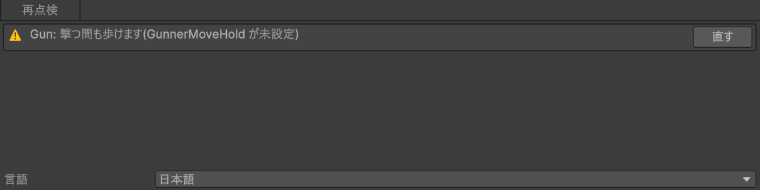

## A. 一本道(撃てる銃を作る)

## 1. 銃のモデルを置く

1. 空の GameObject を作り、名前を `Gun` にする。
2. `Gun` の「位置(Position)」を (0, 1, 0) にする。
3. 用意した銃のモデルの Prefab を、`Gun` の子に置く。
4. 名前を `Model` にする。
5. `Model` の「位置(Position)」と「回転(Rotation)」を (0, 0, 0) にする。
6. モデルにコライダーは付けない。コライダーは 2 章で `Gun` に付けます。

モデルは、+Z の側が銃口です。

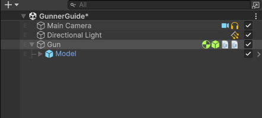

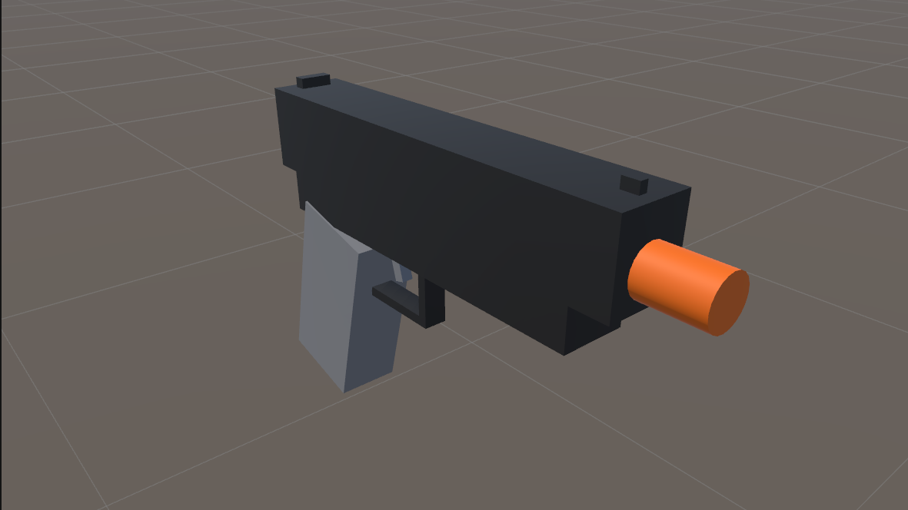

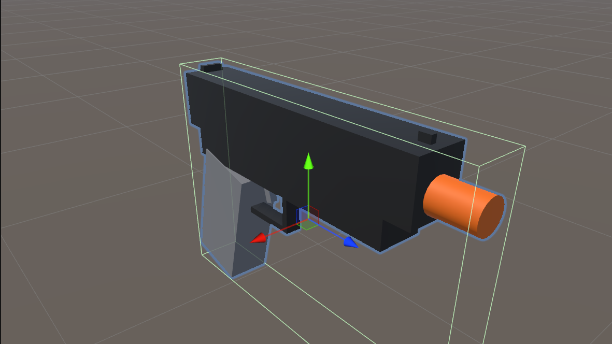

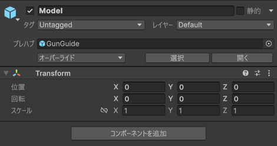

## 2. 手に持てるようにする

`Gun` に、次の 4 つをこの順で付けます。最後にレイヤーを変えます。

1. Rigidbody を付ける。「キネマティックにする(Is Kinematic)」にチェックを入れる。
2. Box Collider を付ける。「中心(Center)」と「サイズ(Size)」を調整して、銃全体を囲む。「トリガーにする(Is Trigger)」は切ったままにする。
3. VRC Pickup を付ける。「Auto Hold」にチェックを入れる。
4. VRC Object Sync を付ける。
5. `Gun` の「レイヤー(Layer)」を Pickup にする。子も変えるか聞かれたら「いいえ」を選ぶ。

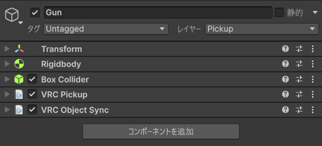

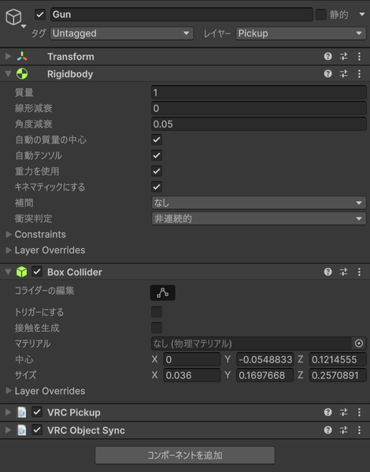

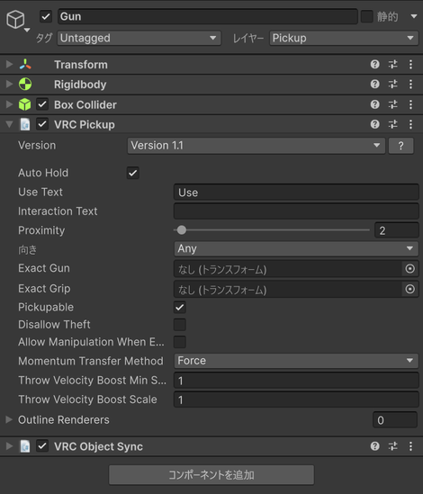

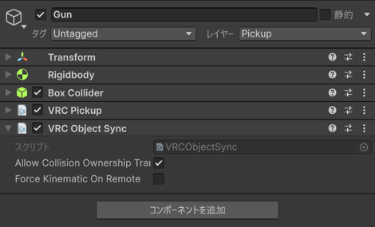

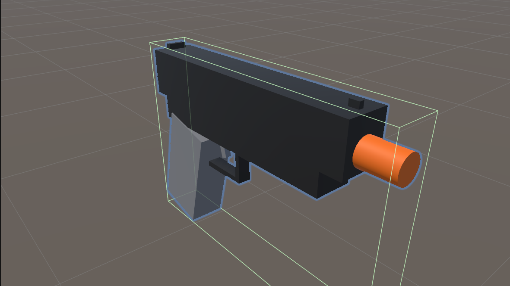

## 3. rig を足す

1. `Gun` を選ぶ。
2. メニューの `GameObject > Gunner > Add Gunner Rig` を選ぶ。

この操作 1 回で、次の階層ができます。

```
Gun
└ GunnerRig
   ├ muzzles
   │  └ Emitter
   │     └ Pivot
   │        └ Shot
   └ Parts
```

- `GunnerRig`: 全体をまとめる部品です。
- `Emitter`: 弾の出る「場所」です。4 章で銃口へ動かします。
- `Pivot`: 弾の「向き」です。+Z が撃つ向きです。
- `Shot`: 弾のパーティクルです。
- `Parts`: 連射の部品(GunnerStream)です。

`Gun` に VRC Object Sync があるので、rig は `Gun` の子に作られます。

UdonBehaviour の Sync Method が Continuous と表示されても、そのままでかまいません。`Gun` の VRC Object Sync に合った値です。

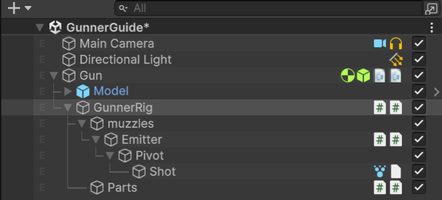

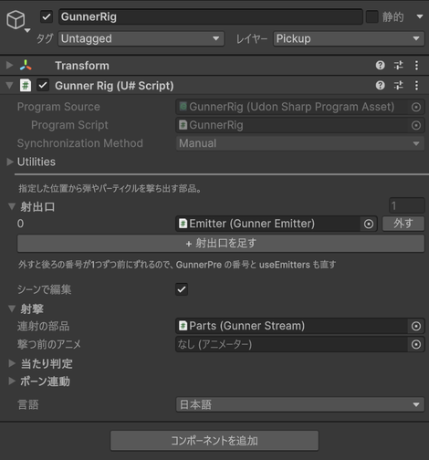

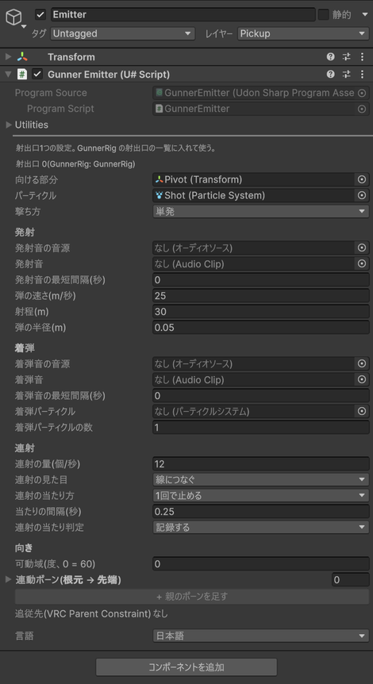

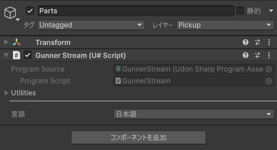

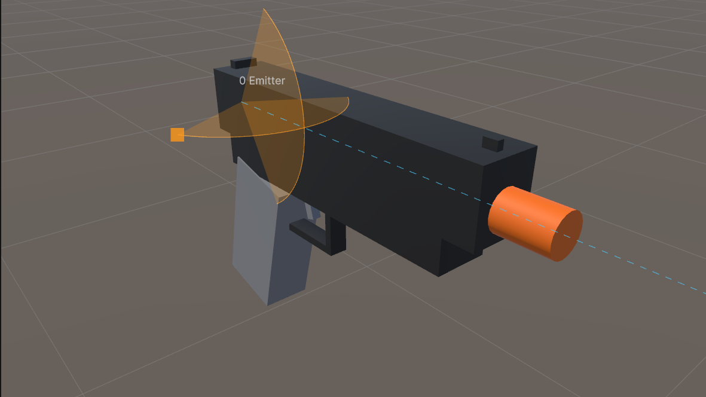

## 4. 射出口を銃口に合わせる

射出口は、できた直後は `Gun` の原点にあります。これを銃口の先へ動かします。動かすのは `Emitter`(場所)です。`Pivot` は動かしません。

1. `Emitter` を選ぶ。
2. 「位置(Position)」を (0, 0, 0.255) にする。
3. 「回転(Rotation)」は (0, 0, 0) のままにする。
4. シーンビューで、青い矢印(+Z)が銃の前を向いていることを確かめる。

0.255 は、銃身の先端(0.250)より 5 mm 前です。弾が銃身の中から出ないようにするためです。この数値は、用意した銃のモデルの寸法に合わせたものです。自分のモデルでは、銃口の先端より少し前の位置にします。

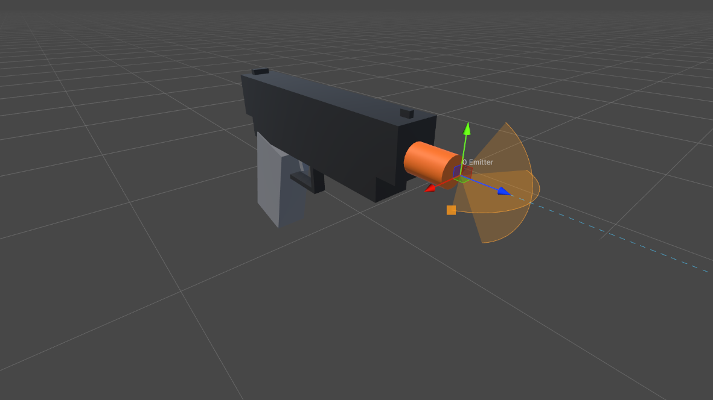

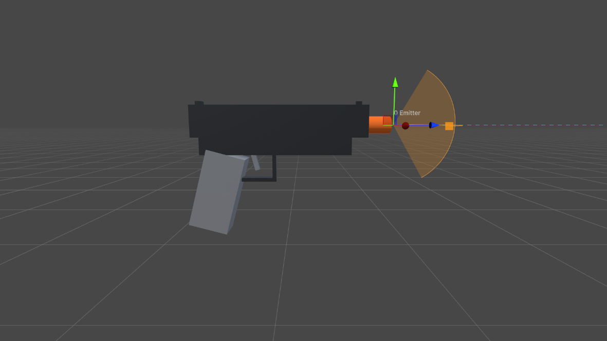

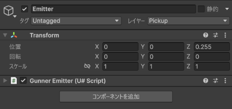

## 5. 引き金をつなぐ

引き金の部品は 2 つです。どちらも `Gun` に付けます。

1. `Gun` に GunnerPickupInput を付ける。
2. `Gun` に GunnerHandController を付ける。
3. GunnerHandController の「GunnerRig」に `GunnerRig` を入れる。
4. GunnerHandController の「入力(Input)」に、`Gun` の GunnerPickupInput を入れる。
5. GunnerPickupInput の「Controller」に、`Gun` の GunnerHandController を入れる。
6. GunnerPickupInput の「撃てる手(Shooting hand)」を「どちらでも(Either)」にする。初期値は左手です。

GunnerPickupInput の「Pickup」と、GunnerHandController の「移動ロック(Move hold)」は、空のままにします。

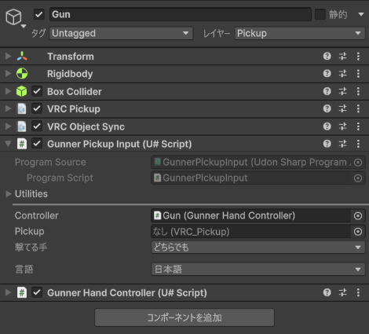

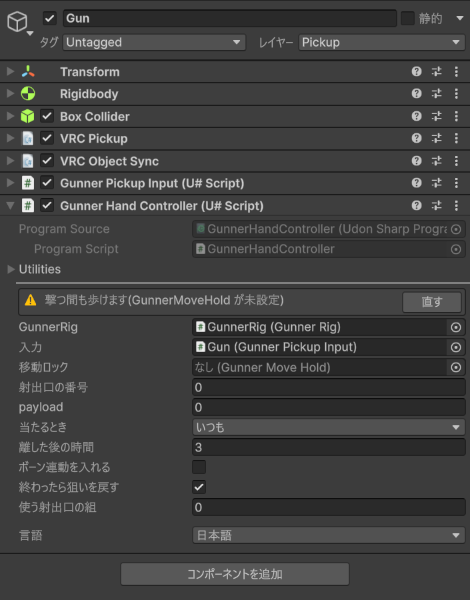

## 6. 点検して撃つ

1. `Tools > Gunner > Check Window` を開く。
2. 出ている項目を読む。ここまでの手順どおりなら、警告もエラーも出ません。
3. 的を置く。銃の前 8 m の所に Cube を作り、Position を (0, 1.5, 8) にする。
4. Play する。シーンに VRCWorld が無いと、ClientSim が動きません(0 章)。
5. 銃を持って、引き金を引く。
6. 弾が出て、的に当たれば完成です。的は、コライダーが付いていれば Cube 以外でもかまいません。

## B. 好きな章を選ぶ(弾を変える)

7〜10 章で扱うのは、Unity 上の設定だけです。ワールドの中で弾を切り替える手順は、この手順書にはありません。

## 7. 弾の見た目を変える

弾の見た目は、`Shot` の Particle System で変えます。

1. `Emitter/Pivot/Shot` を選ぶ。
2. Particle System の「開始時の色(Start Color)」を変える。
3. 「開始サイズ(Start Size)」を変える。
4. 「トレイル(Trails)」の「生存期間(Lifetime)」を変える。

次の欄は変えません。

- 「シミュレーション空間(Simulation Space)」(ワールドのままにします)
- Collision の Collides With(弾が当たるレイヤーを決める欄です)
- 「開始速度(Start Speed)」(弾の速さは、8 章の「弾の速さ(m/秒)(Shot speed (m/s))」で決まります)

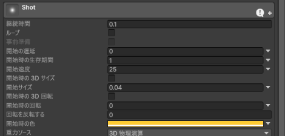

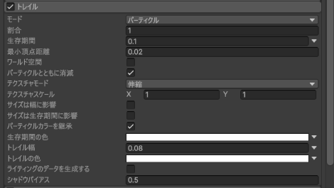

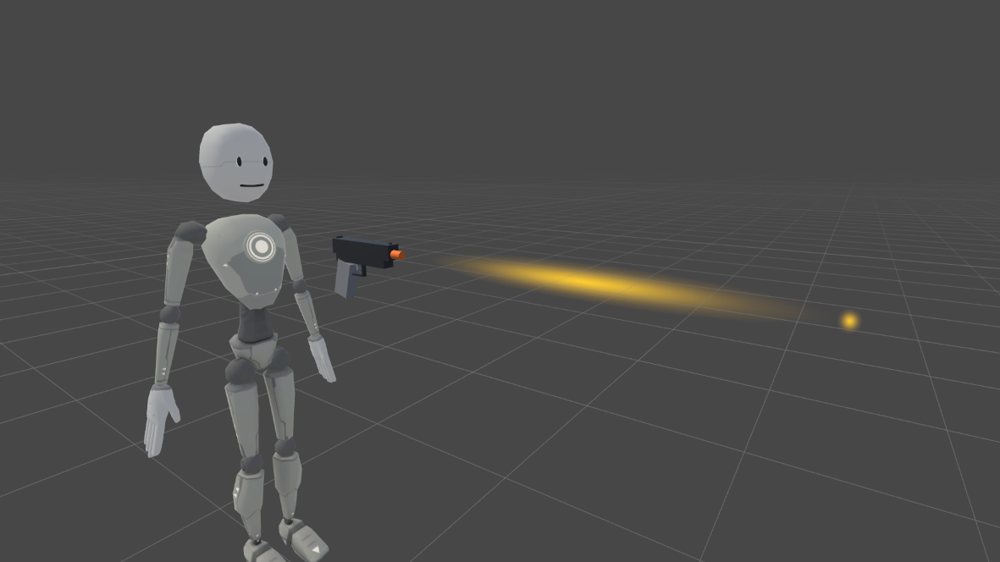

## 8. 撃ち方を変える

撃ち方は、GunnerEmitter の「撃ち方(Fire mode)」で選びます。

- 単発(Single): 引き金 1 回で 1 発。
- 連射(Stream): 引き金を引いている間、弾が流れ続ける。

注意: 「連射(Stream)」は、糸や放水のように途切れず流れる撃ち方です。機関銃のように単発を繰り返す撃ち方ではありません。

1. 撃ち方を変える射出口(GunnerEmitter)を選ぶ。
2. 「撃ち方(Fire mode)」を「連射(Stream)」にする。
3. 必要なら、連射の欄を調整する。初期値のままでも撃てます。

| 欄 | 意味 | 初期値 |
|---|---|---|
| 連射の量(個/秒)(Stream rate (/s)) | 1 秒に出す量 | 12 |
| 連射の当たり方(Stream hits) | 当たったあとの動き | 1回で止める |
| 当たりの間隔(秒)(Hit interval (s)) | 当たりを数える間隔(秒) | 0.25 |
| 連射の当たり判定(Stream collision) | 当たりを記録するか | 記録する |

連射の弾を 1 本の線につなげるかどうかは、GunnerEmitter ではなく、その射出口の `Shot` の Particle System で決めます。

1. 撃ち方を変えた射出口の下の `Pivot/Shot` を選ぶ(射出口が `Emitter_1` なら `Emitter_1/Pivot/Shot`)。
2. 「トレイル(Trails)」にチェックを入れて、「モード(Mode)」を「リボン(Ribbon)」にする。
3. 「レンダラー(Renderer)」の「レンダーモード(Render Mode)」を「なし(None)」にする。粒は見えなくなり、線だけが残ります。

「トレイル」にチェックが入っていないか、「モード」が「パーティクル(Particles)」のままだと、線にならず、粒が流れます。

射出口どうしで Shot の Particle System を共有しないでください。共有すると、線が射出口をまたいでつながります。

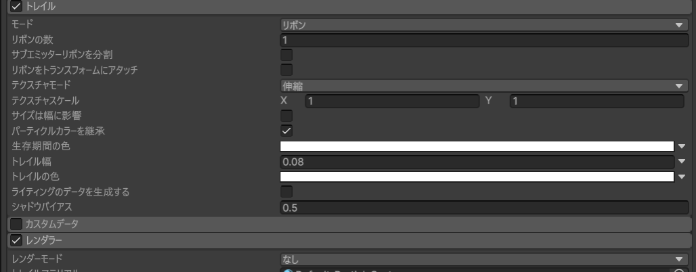

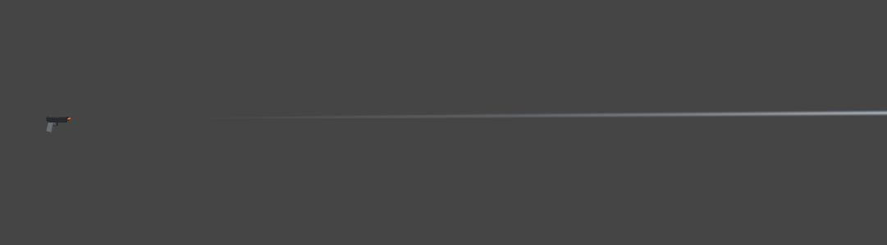

発射の欄は、単発と連射で共通です。

| 欄 | 初期値 |
|---|---|
| 弾の速さ(m/秒)(Shot speed (m/s)) | 25 |
| 射程(m)(Range (m)) | 30 |
| 弾の半径(m)(Shot radius (m)) | 0.05 |

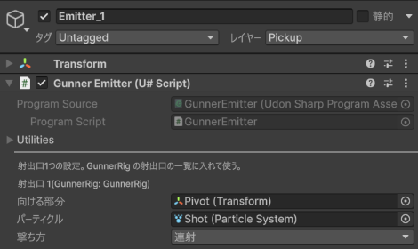

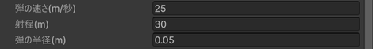

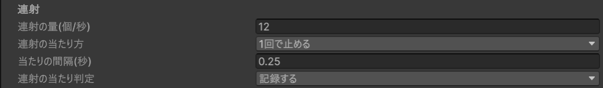

## 9. 弾の種類を増やす

射出口をもう 1 つ足して、別の設定にします。

1. `GunnerRig` を選ぶ。`Gun` を選んだままだと、次のメニューは使えません。
2. メニューの `GameObject > Gunner > Add Emitter` を選ぶ。
3. `muzzles` の下に `Emitter_1` ができたことを確かめる。
4. `Emitter_1` の「位置(Position)」を (0, 0, 0.255) にする。新しい射出口は rig の原点にできるので、4 章と同じように銃口へ動かします。
5. `Emitter_1/Pivot/Shot` の色や大きさを変える(7 章)。
6. `Emitter_1` の「撃ち方(Fire mode)」を変える(8 章)。

どの射出口で撃つかは、GunnerHandController の「射出口の番号(Emitter index)」で選びます。

- 番号は 0 から始まります。`Emitter` が 0、`Emitter_1` が 1 です。
- -1 にすると、引き金 1 回で全部の射出口が同時に撃ちます。

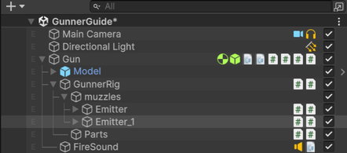

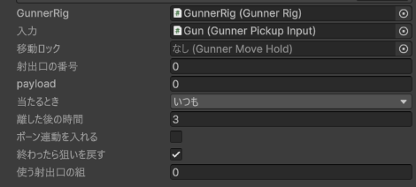

## 10. 音と着弾の演出を付ける

### 発射音

1. `Gun` の子に空の GameObject を作り、名前を `FireSound` にする。「位置(Position)」を (0, 0, 0.25) にする。
2. `FireSound` に AudioSource を付ける。「ゲーム開始時に再生(Play On Awake)」を切り、「立体音響ブレンド(Spatial Blend)」を 1 にする。
3. `FireSound` に VRC Spatial Audio Source を付ける。初期値のままでかまいません。
4. `Emitter` の GunnerEmitter の「発射音の音源(Fire sound source)」に `FireSound` を入れる。
5. 「発射音(Fire sound)」に、効果音(例: `shoot`)を入れる。音は何でもかまいません。

### 着弾音と着弾パーティクル

着弾の演出は、rig の外に置きます。rig の中に置くと、Check Window に警告が出ます。

1. 一番上の階層に空の GameObject を作り、名前を `ImpactSound` にする。`FireSound` と同じ設定の AudioSource(Play On Awake を切り、Spatial Blend を 1 にする)と VRC Spatial Audio Source を付ける。
2. 一番上の階層に Particle System を作り、名前を `ImpactSparks` にする。次のように設定する。
   - 「ゲーム開始時に再生(Play On Awake)」と「ループ(Looping)」を切る。
   - 「開始時の生存期間(Start Lifetime)」を 0.3、「開始速度(Start Speed)」を 2、「開始サイズ(Start Size)」を 0.03 にする。「開始時の色(Start Color)」は好みの色にする。
   - Emission の Rate over Time を 0 にする。
3. `Emitter` の GunnerEmitter の「着弾音の音源(Impact sound source)」に `ImpactSound` を入れる。
4. 「着弾音(Impact sound)」に、効果音(例: `Impact`)を入れる。
5. 「着弾パーティクル(Impact particles)」に `ImpactSparks` を入れる。
6. 「着弾パーティクルの数(Impact burst)」を 8 にする。

連射の射出口では、「着弾音の最短間隔(秒)(Impact sound min interval (s))」を 0.08 にすると、音が重なりすぎません。

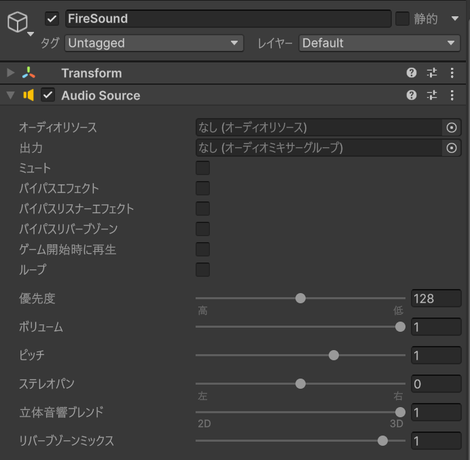

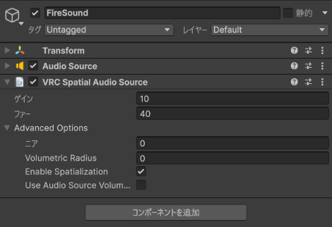

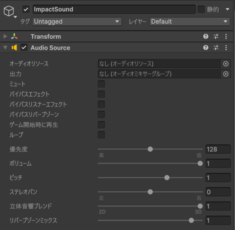

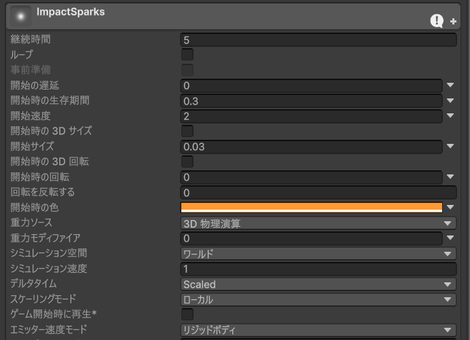

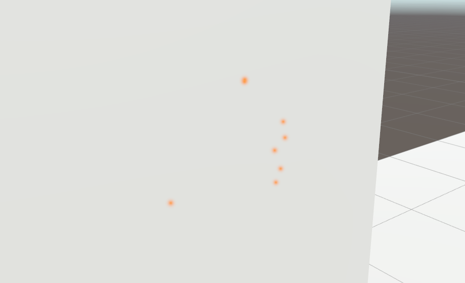

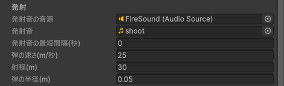

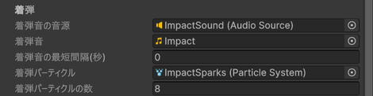

## 付録. 困ったとき

### Check Window の読み方

行をクリックすると、対象のオブジェクトが選ばれます。「直す(Fix)」のボタンがある行は、ボタンを押すと直ります。押す前に、何が変わるかを読んでください。

### Play しても撃てない

- シーンに VRCWorld があるか確かめる(0 章)。
- GunnerHandController の「射出口の番号(Emitter index)」が、撃ちたい射出口の番号か確かめる(9 章)。
- Console にエラーが出ていないか確かめる。

### VR で撃てない

GunnerPickupInput の「撃てる手(Shooting hand)」を確かめます。初期値は左手です(5 章)。

### Sync Method が Continuous と出る

`Gun` に VRC Object Sync があるときは、これが正しい値です。変えません(3 章)。

### 欄の一覧

欄の一覧は、Gunner の README を見てください。

